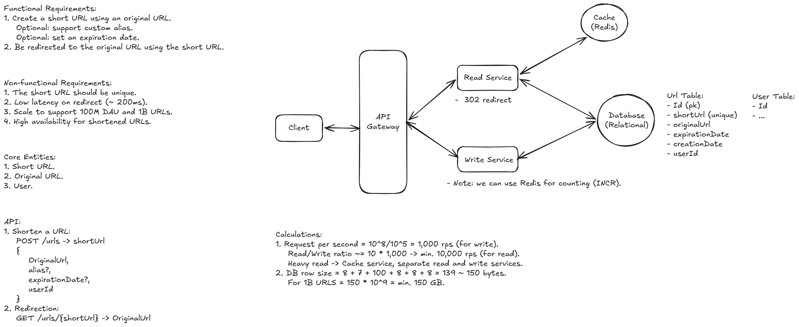

# URL-Shortener 🔗

[](https://dotnet.microsoft.com/)
[]()
[](https://www.microsoft.com/en-us/sql-server)
[](https://redis.io/)

### 📝 Description
A high-performance, enterprise-grade URL Shortener built with **C# and .NET**. This project demonstrates advanced backend engineering by implementing a **Microservices-inspired CQRS architecture**. It separates write operations (Entity Framework Core) from read operations (Dapper) to ensure maximum scalability, utilizing **YARP** as an API Gateway and **Redis** for low-latency distributed caching.

---

### 🏗️ Architecture Diagram
Below is the high-level system design outlining the functional and non-functional requirements, targeting **100M DAU** and **1B URLs**, and detailing the request flow through the API Gateway to the independent Read and Write services.



---

### ✨ App Features
- **Custom Aliases & Auto-Generation:** Create custom vanity URLs or let the system auto-generate highly compact, unpredictable short links.
- **ID Obfuscation (Anti-Scraping):** Uses Hashids to mask sequential database IDs, generating secure, random-looking Base62 strings to prevent URL enumeration and scraping.
- **Lightning Fast Redirects:** Sub-millisecond redirection by fetching URLs directly from the Redis Cache.
- **Link Expiration:** Set specific expiration dates for links, returning a standard `410 Gone` status when expired.
- **Soft Deletion:** Safely delete links without losing historical data, instantly invalidating the cache to prevent stale redirects.

### 🛠️ Code Features
- **CQRS Pattern:** Strict separation of concerns between the **Write API** (Commands) and the **Read API** (Queries).
- **Write-Through Caching:** Solves eventual consistency and read-replica replication lag by pushing new URLs directly to Redis immediately upon database insertion.
- **High-Performance SQL Sequence:** Bypasses standard `IDENTITY` columns by using a custom SQL Database Sequence for extremely fast ID generation.
- **Fail-Fast Configuration (Options Pattern):** Strongly-typed settings with Data Annotations to validate critical configurations (like the cryptographic Salt) at startup.
- **API Gateway (YARP):** Centralized entry point routing traffic securely to the internal microservices.
- **Dual ORM Strategy:** Using **EF Core** for secure, validated data mutations, and **Dapper** for blazing-fast data retrieval.

### 💻 Tech Stack
- **Language:** C#
- **Gateway:** YARP (Yet Another Reverse Proxy)
- **Caching:** Redis (Docker Container)
- **Database:** Microsoft SQL Server
- **ORMs:** Entity Framework Core & Dapper
- **Encoding/Obfuscation:** Hashids.net

---

### ⚠️ Note for Usage & Security
To run this distributed architecture locally on your machine, ensure you have the required infrastructure and configurations in place:

1. **Redis Setup:** You must have a Redis instance running. The easiest way is via Docker:
   `docker run -d -p 6379:6379 redis`
2. **Database Connection:** Check the `appsettings.json` in both `WriteApi` and `ReadApi` projects and update the `DefaultConnection` string to match your local SQL Server instance.
3. **Application Settings:** The application strictly enforces configuration validation on startup. You **must** provide a secure `HashidsSalt` in the `appsettings.json` of the `WriteApi`:
   ```json
   "UrlShortenerSettings": {
     "BaseUrl": "http://localhost:5000/",
     "HashidsSalt": "Your_Super_Secret_Secure_Salt_Here"
   }
   ```
4. **Apply Migrations:** Open the Package Manager Console, set `WriteApi` as the default project, and run `Update-Database` to build the schema and the SQL Sequence.

---

### 🚀 Getting Started
1. Clone the repository.
2. Open the solution in **Visual Studio**.
3. Apply the infrastructure and `appsettings.json` configurations mentioned above.
4. Right-click the Solution -> **Configure Startup Projects**.
5. Select **Multiple startup projects** and set `Gateway`, `ReadApi`, and `WriteApi` to **Start**.
6. Press `F5` to run. Access the Write API via the integrated **Scalar UI**, or test the redirects directly through the Gateway (`http://localhost:5000`).

---

### 🤝 Connect with Me
If you're interested in Software Engineering, Backend Architecture, or AEC Informatics, let's connect:

- [LinkedIn](https://linkedin.com/in/agaabdelgawad)
- [YouTube Channel](https://youtube.com/@agaabdelgawad)
- [GitHub Profile](https://github.com/agaabdelgawad)

---
*If you found this project interesting or helpful, feel free to give it a ⭐!*
